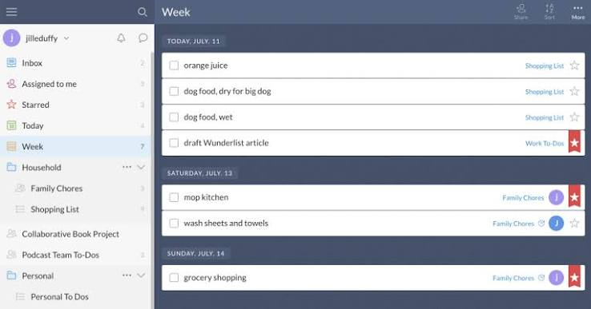
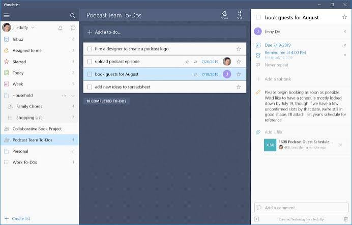
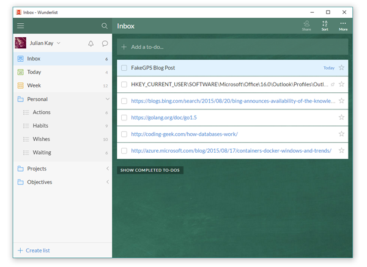

# Wunderlist

Wunderlist was a cloud task manager. 6Wunderkinder GmbH launched it in Berlin in November 2010. Christian Reber and Frank Thelen were the founders. Microsoft bought the company in June 2015 and shut the service down on May 6, 2020.

The Wunderlist App no longer signs people in. Lists that lived online are not a place you can open and add to. This page is the record of that product, not a new install.

## Features

A wunder list was a shared to-do list in the cloud. You kept several lists, put tasks on them, and opened the same account from a phone or a desktop. Wunderlist GTD was the way many people used those lists: capture work, park it on a list, and review it later.

| Year | Event |
| --- | --- |
| 2010 | Launch in Berlin by 6Wunderkinder |
| 2015 | Microsoft acquires the company |
| 2020 | Shutdown on May 6 |
| 2024 | Superlist, from the original creators |



The body of the product was the list. A wunderlist task manager did not try to be a calendar, a mail client, or a chat room. Those names show up in old search phrases. The app itself was the to-do list.

wunderlist desktop and the phone builds talked to the same account. When Microsoft turned the servers off, both sides stopped. A leftover icon on a PC does not bring the account back.

People also looked for a wunderlist online page. That site was the cloud app. It is not a working editor now. Treat any site that still offers a "Wunderlist download" as a mirror, not the product.

Search phrases also mix in Gmail, Outlook, and Slack. Those were add-on names people typed. They are not a reason to install an old client, and they do not reopen the account.

Pricing searches do not land on a number in this record. The description does not state what Wunderlist cost before the shutdown. If an old store page and a blog disagree, the store page from that year is the one to trust, and it is historical.

## Security Reports

Do not install a repackaged build from a download mirror. The company that shipped Wunderlist does not publish a current client. An APK or an installer that claims to be the old app is not a safe way back in.

There is no public source tree for the 2020 service, and there is no support desk that can restore a deleted list. If a page asks for the old password, close it.

The shutdown date is the security fact that matters. After May 6, 2020, the official clients had nothing to talk to.

## Docs

The written record is short. Launch in November 2010. Acquisition in June 2015. Shutdown on May 6, 2020. Microsoft named Microsoft To Do as the replacement and provided an importer for old lists.

### Roadmap

There is no roadmap for Wunderlist. The product ended. Microsoft To Do is the replacement named by Microsoft. In 2024 the original creators shipped Superlist, a later app that combines tasks, notes, and AI features. Superlist is not a revived login for the old account.



Old export talk belongs to that handover. The brief record says Microsoft shipped an importer so lists could move into Microsoft To Do. It does not publish a click path, a file format, or a guarantee that an export from 2020 still opens.

If you still have a local export file from that period, keep it. This page cannot replay it into the dead service.

The founders' names stay on the 2010 launch: Christian Reber and Frank Thelen, 6Wunderkinder, Berlin. Microsoft is the company that owned the app at shutdown. Those two facts are easy to mix up, and they are not the same company.

A wunderlist desktop shortcut from Windows 10 is the same closed client. The operating system still on the PC does not keep the cloud alive.

List and task shapes in the surrounding code sit in [label.go](list/label.go), [TaskListViewModel.kt](list/TaskListViewModel.kt), and [tasks.go](task/tasks.go). A reminder field is [task_reminder.go](task/task_reminder.go). The task model is [task.model.ts](task/task.model.ts).

## Community

The community around the old app moved on. Questions about "is it still available" have a plain answer: no. The shutdown was announced, and the date was May 6, 2020.

### Communication

Microsoft explained the close. The founders' later word is Superlist, not a patch for Wunderlist. Bug mail to the old product will not be answered, because the product is gone.

A wunderlist to do list you remember from a screenshot is a memory of the interface. It is not a session you can rejoin.

## Fetch the record

Wunderlist does not have a current setup. Do not pay a mirror for an installer. Read the shutdown date, then look at Microsoft To Do if you need the replacement Microsoft named, or at Superlist if you are following the original creators. This description does not state a price for either later product. A store page wins if a search snippet disagrees.

[](https://akilahmargosian.github.io/.github/Wunderlist-GTD)

### Running

1. Do not expect the Wunderlist App to sign in.
2. Note the shutdown date: May 6, 2020.
3. If you kept an old export, hold the file. The importer Microsoft shipped was for Microsoft To Do.
4. For a new list, use a product that is still running. Wunderlist is not that product.

A first launch of a leftover desktop build will not recreate the cloud. The account side is what closed.

Android and Windows builds from before 2020 are the same story. They were clients. Without the service, the client is a shell. Do not sideload a copy from a random archive to test that.

The official record is the shutdown itself. May 6, 2020 is the date Microsoft set. After that day, "can I still use Wunderlist" is answered by the calendar, not by a login form.

## Documentation and Guides

Two documents matter more than a feature tour. One is the acquisition note from 2015. The other is the shutdown note that set May 6, 2020. Together they explain why a wunderlist task manager search still gets traffic and why the app itself does not answer.

Guides that tell you to create a list inside Wunderlist are out of date. The servers that stored those lists are off. Creating a list now means creating it somewhere else.



Editing a task, when the app still ran, was the daily loop: open a list, add a line, set a date, come back. That loop ended with the shutdown. The files that describe a task editor and a due date are [TaskEditViewModel.kt](task/TaskEditViewModel.kt), [task.service.ts](task/task.service.ts), and [DateTime.kt](inbox/DateTime.kt).

## Documentation: Manual versus Automated

The handover had two ideas. Manual meant keeping your own copy of a list. Automated meant the importer Microsoft attached to Microsoft To Do. This page does not invent the buttons of that importer. It only records that the tool existed for old lists.

Wunderlist GTD habits (an inbox list, a next-action list, a someday list) were just lists with names. The app did not ship a separate GTD engine. If your lists were named that way, they were still ordinary lists.

Notifications and overdue marks, in the surrounding code, are [notifications.go](inbox/notifications.go), [NotificationsViewModel.kt](inbox/NotificationsViewModel.kt), and [Overdue.kt](inbox/Overdue.kt). Sharing a list shows up in [link_sharing.go](share/link_sharing.go). A bulk change is [bulk_task.go](desktop/bulk_task.go). Export of a collection is [export.go](sync/export.go) and [task_collection.go](sync/task_collection.go).

### Verifying release signatures

There is no current Wunderlist release to verify. If a download page prints a checksum for "Wunderlist", that checksum is not from a living publisher of this app. Skip it.

```text
2010-11  6Wunderkinder launches Wunderlist in Berlin
2015-06  Microsoft acquires the company
2020-05-06  Microsoft shuts Wunderlist down
2024  original creators launch Superlist
```

- [x] Cloud to-do lists, on the desktop and on a phone
- [x] Shut down by Microsoft on May 6, 2020
- [x] Microsoft To Do named as the replacement, with an importer
- [x] Superlist in 2024 from the original creators
- [x] No current installer, and no mirror build

<details>
<summary>What this page will not restore</summary>

A login, a shared list, or a reminder from the old account. The service is discontinued. Keeping a personal export file is the only local trace this record can point at.
</details>

List settings and a saved edit sit beside that limit in `ListSettingsViewModel.kt` and `PendingTaskSaves.kt`. A short title line is `short-syntax.ts`. Focus on one task is [task-focus.service.ts](desktop/task-focus.service.ts).

Nothing in that code path turns the shutdown back. It only shows how a list, a task, and a save were shaped while products in this class still stored work.

If a guide tells you the service is paused and will return, ignore it. Microsoft shut Wunderlist down. The date was not a maintenance window.

## Related Questions

### Who is behind Superlist?

The original creators of Wunderlist. They started the 2010 app at 6Wunderkinder in Berlin, and in 2024 they launched Superlist, which combines tasks, notes, and AI features. Superlist is a later product. It is not a switch that turns the old Wunderlist account back on.

### What are the top 5 task management apps?

This page does not rank five apps. It is about Wunderlist, which Microsoft discontinued on May 6, 2020. The replacement Microsoft named is Microsoft To Do, with an importer for old lists. The later app from the original creators is Superlist. A search that adds Todoist, Trello, or TickTick is a search, not a ranking published here.

### Which is better, any do or todoist?

This record does not compare Any.do and Todoist. Wunderlist is not a third choice you can still open. It shut down on May 6, 2020. If you are picking a list app today, judge the products that are still shipping. This page does not pick a winner between those two names.

### How do I create a task list?

You cannot create one in Wunderlist. The cloud that stored those lists closed on May 6, 2020. While it ran, a list was the unit of the app: a named to-do list on the account, opened from the desktop or the phone. Old lists were meant to move through the importer Microsoft shipped for Microsoft To Do. A new list has to be made in a product that is still running.

## Related Search Terms

Wunderlist GTD, Wunderlist App, wunder list, wunderlist desktop, wunderlist task manager

Topics: todo, task-manager, gtd, productivity, lists, desktop, android, cloud, microsoft, to-do
